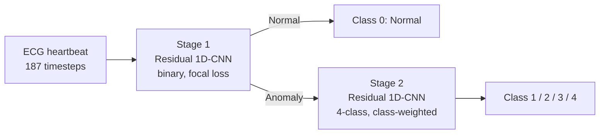

# ECG Heartbeat Anomaly Detection (Two-Stage Deep Learning)

A two-stage deep learning pipeline that first detects abnormal heartbeats in ECG
signals and then classifies *which kind* of abnormality it is. Built on the
[MIT-BIH Arrhythmia dataset](https://www.kaggle.com/datasets/shayanfazeli/heartbeat)
with TensorFlow / Keras.

| | Stage 1: Normal vs. Anomaly | Stage 2: Anomaly sub-type | Full pipeline (5 classes) |
|---|---|---|---|
| **Accuracy** | 99% | 96% | 98% |
| **Macro F1** | 0.98 | 0.92 | 0.90 |

All numbers are on the held-out test set (21,892 heartbeats).

## Overview

Most heartbeats are normal and abnormal ones are rare and diverse, so a single
5-class classifier struggles with the minority classes. This project splits the
problem in two:



1. **Stage 1: binary anomaly detector.** A residual 1D-CNN trained with focal loss
   decides *Normal vs. Anomaly*. Its decision threshold is tuned on a validation
   split (not on the test set) to maximize anomaly F1.
2. **Stage 2: anomaly sub-type classifier.** Only heartbeats flagged by Stage 1 are
   passed to a second residual 1D-CNN trained on the four abnormal classes (1-4)
   with balanced class weights.

## Dataset

- **Source:** [MIT-BIH Arrhythmia Dataset (Kaggle)](https://www.kaggle.com/datasets/shayanfazeli/heartbeat),
  preprocessed heartbeats of 187 timesteps each.
- **Split:** 87,554 training beats and 21,892 test beats.
- **Classes:** `0` Normal, `1`-`4` different arrhythmia types (N, S, V, F, Q in the
  dataset description). The data is heavily imbalanced: about 83% of the training
  set is Class 0.

| Class | Train | Test |
|-------|------:|-----:|
| 0 (Normal) | 72,471 | 18,118 |
| 1 | 2,223 | 556 |
| 2 | 5,788 | 1,448 |
| 3 | 641 | 162 |
| 4 | 6,431 | 1,608 |

## Models

Both stages share the same residual block design: two `Conv1D` layers (kernel 5)
with batch normalization, a skip connection (1x1 conv when channel counts differ),
ReLU, and max-pooling.

```
Input (187, 1)
 -> ResBlock(32) -> ResBlock(64) -> ResBlock(128)
 -> Flatten -> Dense(64, ReLU) -> Dropout
 -> Dense(1, sigmoid)   [Stage 1]   or   Dense(4, softmax)   [Stage 2]
```

| | Stage 1 | Stage 2 |
|---|---|---|
| Task | Normal vs. Anomaly (binary) | Anomaly type (Classes 1-4) |
| Training data | All training beats, 85/15 stratified train/val split | Anomalous beats only (Classes 1-4), 15% validation split |
| Loss | Binary focal cross-entropy (gamma = 2, alpha = 0.75) | Sparse categorical cross-entropy with balanced class weights |
| Dropout | 0.4 | 0.3 |
| Optimizer | Adam, lr 1e-3 (ReduceLROnPlateau) | Adam, lr 1e-3 |
| Batch / max epochs | 128 / 25 | 64 / 30 |
| Early stopping | Patience 5 on val loss, best weights restored | Patience 5 on val loss, best weights restored |
| Decision rule | Threshold 0.56, chosen on validation F1 | Argmax |

## Results

### Stage 1: Normal vs. Anomaly (test set)

| Metric | Normal (0) | Anomaly (1-4) |
|---|---|---|
| Precision | 0.99 | 0.98 |
| Recall | 1.00 | 0.95 |
| F1-score | 0.99 | 0.96 |

Overall accuracy: **99%** | Macro F1: **0.98**

### Stage 2: anomaly sub-type, evaluated in isolation on true anomalies

| Class | Precision | Recall | F1-score | Support |
|---|---|---|---|---|
| 1 | 0.97 | 0.95 | 0.96 | 556 |
| 2 | 0.98 | 0.95 | 0.96 | 1,448 |
| 3 | 0.66 | 0.96 | 0.78 | 162 |
| 4 | 0.99 | 0.99 | 0.99 | 1,608 |

Overall accuracy: **96%** | Macro F1: **0.92**

Class 3 is the smallest class (641 training beats). Class weighting pushes the
model to catch almost every true Class 3 beat (recall 0.96) at the cost of
precision (0.66), because some beats from other classes are predicted as Class 3.

### Full end-to-end pipeline

Stage 1 routes each beat and only flagged beats reach Stage 2, so Stage 1 misses
carry through to the final prediction.

| Class | Precision | Recall | F1-score | Support |
|---|---|---|---|---|
| Normal (0) | 0.99 | 1.00 | 0.99 | 18,118 |
| 1 | 0.88 | 0.79 | 0.83 | 556 |
| 2 | 0.98 | 0.93 | 0.95 | 1,448 |
| 3 | 0.67 | 0.81 | 0.74 | 162 |
| 4 | 0.99 | 0.98 | 0.99 | 1,608 |

Overall accuracy: **98%** | Macro F1: **0.90** | Weighted F1: **0.98**

Compared with Stage 2 in isolation, recall drops for Class 1 (0.95 to 0.79) and
Class 3 (0.96 to 0.81). This is the cost of Stage 1 labelling about 5% of true
anomalies as normal before they ever reach Stage 2.

## Why Stage 1 is supervised: autoencoder baseline

The first version of Stage 1 was an unsupervised **1D-CNN autoencoder** trained
only on normal beats (MSE loss, 30 epochs), flagging beats with high
reconstruction error. The threshold was set at the 80th percentile of the
reconstruction error of normal test beats. It did not separate the classes well
enough:

| Stage 1 approach | Accuracy | Anomaly precision | Anomaly recall | Anomaly F1 |
|---|---|---|---|---|
| Autoencoder + reconstruction-error threshold | 0.77 | 0.39 | 0.61 | 0.47 |
| **Residual 1D-CNN + focal loss (used)** | **0.99** | **0.98** | **0.95** | **0.96** |

Average reconstruction error (MAE) per test class shows why:

| Class | 0 | 1 | 2 | 3 | 4 |
|---|---|---|---|---|---|
| Mean error | 0.0048 | 0.0059 | 0.0052 | 0.0030 | 0.0071 |

Class 3 beats are reconstructed *better* than normal beats on average, and
Classes 1 and 2 are only slightly worse, so no single error threshold can catch
them. Using labels for the binary decision solved this, and focal loss plus a
validation-tuned threshold handled the class imbalance.

The notebook also contains commented-out starting points for a One-Class SVM and a
Deep SVDD (latent-space distance) baseline. These were not run.


## Project Structure

```
.
├── anomaly_2models.ipynb   # Data prep, autoencoder baseline, Stage 1, Stage 2, evaluation
├── requirements.txt
├── LICENSE
└── README.md
```

## Getting Started

### 1. Clone and install dependencies
```bash
git clone https://github.com/hagerhegazy/Two-stages-anomaly-detector-on-the-MIT-BIH-ECG-dataset.git
cd Two-stages-anomaly-detector-on-the-MIT-BIH-ECG-dataset
pip install -r requirements.txt
```

### 2. Set up Kaggle credentials
The notebook downloads the data with the Kaggle API. Set up your credentials
following the [official Kaggle API docs](https://github.com/Kaggle/kaggle-api#api-credentials)
(a `~/.kaggle/kaggle.json` file or environment variables). **Never hard-code or
commit your API key.**

### 3. Run the notebook
```bash
jupyter notebook anomaly_2models.ipynb
```
In the original Colab run, Stage 1 took about 3 minutes per epoch and Stage 2
about 30-40 seconds per epoch, so the full notebook takes roughly 1-1.5 hours.


## Dataset Credit

Heartbeat data from the MIT-BIH Arrhythmia Database (PhysioNet), as preprocessed
and shared on Kaggle by Shayan Fazeli.

## License

MIT, see [LICENSE](LICENSE).
